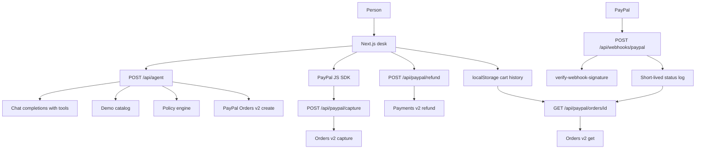

# AgentCart

AgentCart is a purchasing agent for the PayPal AI Hackathon (Devpost deadline 12 November 2026, 12:00 PT). A person types a request such as “Order coffee beans and cups for a 5-person team next week, budget $80.” The agent searches a built-in catalog, builds a cart, checks spending rules, and — when the rules pass or a person approves an exception — creates a real PayPal **sandbox** order. The buyer approves it with the PayPal JavaScript SDK. The server captures the payment, can refund all or part of it, and accepts PayPal webhooks.

The catalog is fictional. Nothing in it is a real brand. Payments are sandbox charges when PayPal credentials are configured. Unit tests mock PayPal and the model, so `npm test` does not call either service.

## Architecture



PayPal is the source of truth for order, capture, and refund status. This browser stores the request, the priced cart, the agent trace, and the order id in `localStorage`. There is no database. The webhook handler keeps a short log on the server instance (`/tmp` when the filesystem is writable) so a warm function can show the latest event. A cold start loses that log; refreshing an order reads PayPal again.

The model never sets prices. Catalog SKUs are priced on the server. `create_paypal_order` runs the same policy check as the checkout button. If a rule fails and the approved lines do not match the cart, PayPal is not called.

### Agent tools

| Tool | What it does |
| --- | --- |
| `search_catalog` | Finds products in the demo catalog |
| `plan_cart` | Picks one product per goal, sizes it for the team and days, then reduces consumables to the budget |
| `propose_cart` | Replaces the cart with explicit SKUs and quantities |
| `request_human_approval` | Pauses when policy fails |
| `create_paypal_order` | Creates a sandbox order when policy passes, or when the person approved that exact cart |
| `get_paypal_order` | Reads status, items, and capture ids |
| `list_known_orders` | Reads the orders the browser sent with the request |
| `refund_capture` | Full refund, dollar amount, or a partial refund matched to an item such as “cups” |

If the model plans a cart that passes policy and then stops, the server creates the PayPal order itself and records that step in the trace. A failing cart is not sent to PayPal. The desk shows the violations and an approval button. That button calls `POST /api/checkout`, which re-prices the cart and checks the approval on the server.

Refunds from chat require `get_paypal_order` in the same turn, and the capture id has to be on that order. The order page can also refund a capture through the same Payments API. That form is a manual control, not the agent.

### Why this does not use `@paypal/agent-toolkit`

The toolkit can create orders, but its `create_order` tool takes prices from the model. AgentCart has to price from the catalog and refuse a cart that breaks policy. Calling Orders v2 and Payments v2 directly keeps that gate in one place and keeps the tests free of the toolkit’s SDK clients. The PayPal JavaScript SDK (`@paypal/react-paypal-js`) is used for buyer approval.

### Policy

Defaults, editable in the Policy panel and stored in this browser:

- Budget cap $150
- Per-item max $60 (the line total, quantity times unit price)
- No blocked categories

The budget in the sentence also applies. The effective cap is the lower of the two. “Next week” is planned as 5 office days. House blend is about 16 mugs per bag, and the planner assumes 2 mugs per person per day. For the sample coffee order that is 4 bags before the budget trim, then 2 bags plus 5 cups, **$74.00**.

A per-person item is not quietly reduced below one per person. If that line breaks the per-item max or the budget, the agent stops for approval.

### PayPal calls

| Step | API |
| --- | --- |
| Access token | `POST /v1/oauth2/token` |
| Create order | `POST /v2/checkout/orders` with `intent: CAPTURE` |
| Capture | `POST /v2/checkout/orders/{id}/capture` |
| Read | `GET /v2/checkout/orders/{id}` |
| Refund | `POST /v2/payments/captures/{capture_id}/refund` |
| Verify webhook | `POST /v1/notifications/verify-webhook-signature` when `PAYPAL_WEBHOOK_ID` is set |

Orders are created with `shipping_preference: NO_SHIPPING` so a sandbox buyer is not asked for an address. Card, Venmo, Pay Later, and credit buttons are hidden so the sandbox PayPal login is the obvious path. Capture is idempotent on PayPal’s `ORDER_ALREADY_CAPTURED` error: the server loads the order and returns it.

`POST /api/agent` allows 12 requests per minute per IP, best-effort in memory on each server instance. Checkout, capture, and refund routes are limited too. The webhook is not rate-limited, so PayPal retries are not dropped.

## Setup

Requirements: Node.js 20 or newer.

```bash
npm install
cp .env.example .env.local
```

Fill `.env.local`. Do not commit it.

| Variable | Purpose |
| --- | --- |
| `LLM_BASE_URL` | OpenAI-compatible base URL. Default `https://opencode.ai/zen/v1` |
| `LLM_API_KEY` | Bearer token for that endpoint |
| `LLM_MODEL` | Default `claude-haiku-4-5` |
| `PAYPAL_CLIENT_ID` | Sandbox REST app client id |
| `PAYPAL_CLIENT_SECRET` | Sandbox REST app secret |
| `PAYPAL_ENV` | `sandbox` (default) or `live` |
| `NEXT_PUBLIC_PAYPAL_CLIENT_ID` | Same client id, exposed to the PayPal JS SDK |
| `PAYPAL_WEBHOOK_ID` | Optional. Turns on signature verification |

PayPal setup:

1. In the [PayPal Developer Dashboard](https://developer.paypal.com/dashboard/), open **Apps & Credentials** and choose **Sandbox**.
2. Create a REST app and copy the client id and secret.
3. Under **Sandbox → Accounts**, create or open a **Personal** account. That is the buyer. The app’s **Business** account is the merchant.
4. Put the client id in both `PAYPAL_CLIENT_ID` and `NEXT_PUBLIC_PAYPAL_CLIENT_ID`.

```bash
npm run dev
```

Open [http://localhost:3000](http://localhost:3000).

`npm run build` produces a Next.js App Router app that can be deployed on Vercel Hobby. Set the same environment variables in the Vercel project. `NEXT_PUBLIC_PAYPAL_CLIENT_ID` is public by design. Never put the secret in a `NEXT_PUBLIC_` variable.

## Testing for judges

Automated checks, with PayPal and the model mocked:

```bash
npm test
npm run build
```

End-to-end sandbox checkout:

1. Start the app with the environment variables above.
2. Leave the default policy in place.
3. Send: `Order coffee beans and cups for a 5-person team next week, budget $80`.
4. Read the agent trace. It should show catalog planning, a policy pass, and a PayPal order id. The cart should be 5 Day Cups and 2 House Blend bags, $74.00, unless the model picks an equivalent explicit cart that still passes policy.
5. Use the PayPal button and sign in with the sandbox **personal** account.

Sandbox buyer login: to be filled later

6. After capture, open **Orders**. Status is read from PayPal. The trace stored in this browser is shown on the order page.
7. To see human approval, set the per-item max to `$20` and send the same coffee request. Five cups are $45, so the agent must stop. Choose **Approve exception and create PayPal order**, then pay or abandon that second order.
8. Refund from the desk: `Refund the cups, they arrived broken`. The trace should include `get_paypal_order` and `refund_capture` for the cup line ($45.00) when that order is in this browser and the capture succeeded. The order page can refund a line, a custom amount, or the full capture through the same API.

Webhook setup (optional, needs a public HTTPS URL):

1. In the sandbox app, add a webhook listener: `https://YOUR_DOMAIN/api/webhooks/paypal`.
2. Subscribe to `CHECKOUT.ORDER.APPROVED`, `CHECKOUT.ORDER.COMPLETED`, `PAYMENT.CAPTURE.COMPLETED`, `PAYMENT.CAPTURE.PENDING`, `PAYMENT.CAPTURE.DENIED`, and `PAYMENT.CAPTURE.REFUNDED`.
3. Copy the webhook id into `PAYPAL_WEBHOOK_ID` and redeploy or restart.
4. Pay or refund again. **Orders** lists events received by this server instance. Verified events update the per-order webhook status shown on the order page.

If `PAYPAL_WEBHOOK_ID` is empty, the endpoint still accepts JSON and records it as unverified so a local tunnel can be inspected. Do not leave it that way on a public URL.

## What this demo does not do

- It does not charge a live PayPal account unless `PAYPAL_ENV=live`. The interface warns when that is set. The hackathon path is sandbox.
- It has no user accounts. “Approve” is a confirmation in this browser, enforced again on the server for that cart, not an enterprise approval chain.
- It does not remember orders on another computer. Paste a PayPal order id on the Orders page to read live status.
- The webhook log does not survive a cold start.
- The in-memory rate limit is per server instance.

## Built with

- Cursor cloud agent, in November 2026
- Next.js App Router, React, TypeScript
- PayPal Orders v2, Payments v2 refunds, webhook signature verification, and the PayPal JavaScript SDK
- An OpenAI-compatible chat-completions endpoint with tool calling
- Vitest

License: MIT. See [LICENSE](LICENSE).
